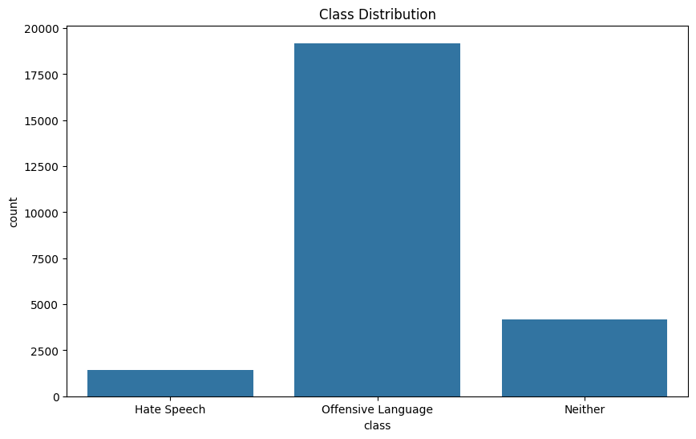
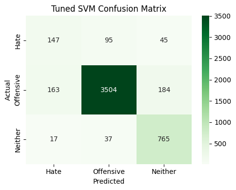
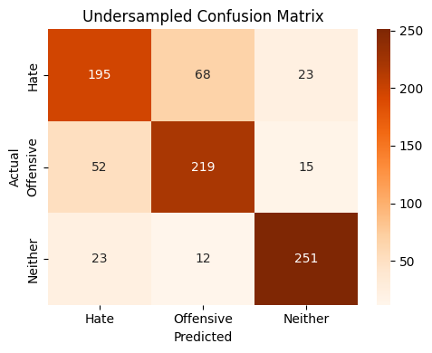

# Hate Speech Detection on Twitter

Comparing classical machine learning and deep learning models for telling **hate speech** apart from merely **offensive language** in tweets, and seeing how much class imbalance affects the results.

Course project for CSE427 Machine Learning, BRAC University, Spring 2025.

## The problem

Social platforms carry far more content than people can review, so moderation leans on automatic classifiers. The hard part is not spotting rude tweets but separating two classes that look alike:

- **Hate speech** attacks a group based on identity, such as race, religion, gender or sexuality.
- **Offensive language** is crude or abusive but doesn't target a group.

The data makes this harder. Only about 6% of tweets are hate speech, so a model can score high accuracy while almost never detecting it. This project measures that gap directly.

## Dataset

[Hate Speech and Offensive Language](https://huggingface.co/datasets/tdavidson/hate_speech_offensive) (Davidson et al., 2017): 24,783 English tweets, each labeled by human annotators.

| Class | Share of tweets |
|---|---|
| Hate speech | 6% |
| Offensive language | 77% |
| Neither | 17% |



## Approach

1. **Cleaning.** Removed HTML entities, retweet markers, mentions, URLs and punctuation; kept hashtag words without the `#`; expanded contractions; split camel-case words; normalized repeated letters ("soooo" to "so"); lowercased; lemmatized. Stopwords were removed, but negations such as "not" and "never" were kept because they change meaning.
2. **Features.** TF-IDF vectors for the classical models; tokenized sequences padded to 100 tokens for the RNN; the BERT tokenizer for BERT.
3. **Models.**
   - Logistic Regression, Random Forest and XGBoost, all on TF-IDF features
   - Linear SVM with class weighting, with C tuned by 5-fold cross-validation on macro F1
   - A simple RNN, trained with 5-fold stratified cross-validation and extra weight on the hate class
   - `bert-base-uncased`, fine-tuned on only 10% of the training data as a few-shot setting (5 epochs, learning rate 2e-5)
4. **Handling imbalance.** Class weights first; then **undersampling**, which cuts the two large classes down to the size of the hate class (1,430 tweets each) and retrains on the balanced set.
5. **Evaluation.** Precision, recall and F1 for each class, macro F1 and accuracy, with an 80/20 train/test split. Hate-class F1 is the number that matters most here.

## Results

**On the real, imbalanced test set** (4,957 tweets; BERT used its own 2,479-tweet split):

| Model | Hate F1 | Macro F1 | Accuracy |
|---|---|---|---|
| Logistic Regression | 0.42 | 0.72 | 0.85 |
| Random Forest | 0.42 | 0.70 | 0.83 |
| XGBoost | 0.32 | 0.71 | 0.91 |
| Linear SVM (tuned, C = 0.1) | **0.48** | **0.75** | 0.89 |
| RNN (5-fold CV) | 0.29 | 0.66 | 0.83 |
| BERT, few-shot | 0.04 | 0.61 | 0.90 |

**After undersampling to balanced classes** (858-tweet balanced test set):

| Model | Hate F1 | Macro F1 | Accuracy |
|---|---|---|---|
| Linear SVM | **0.70** | **0.77** | 0.78 |
| RNN | 0.64 | 0.75 | 0.75 |

| Linear SVM, imbalanced data | Linear SVM, undersampled |
|---|---|
|  |  |

## What I found

- **Accuracy hides the failure.** BERT and XGBoost had the highest accuracy (0.90 and 0.91), yet BERT caught about 2% of hate tweets, a hate-class F1 of 0.04. Both mostly learned to predict the majority "offensive" class.
- **A tuned linear SVM was the best all-round model** on the real distribution, with the highest hate-class and macro F1.
- **Balancing the data helped the hate class most.** With undersampling, the SVM's hate-class F1 rose from 0.48 to 0.70, at the cost of lower overall accuracy.
- **Hate speech and offensive language are easily confused.** Most hate-speech errors were predicted as offensive rather than neutral, which matches how close the two classes are.

## Limitations

- The undersampled models were tested on a balanced split, not the real 6/77/17 mix, so their scores are not directly comparable with the first table. They show what balancing does to the hate class; they don't predict real-world performance.
- BERT saw only 10% of the training data and no class rebalancing, so these results understate what BERT can do with the full dataset.
- The data is English tweets from 2017; slang and coded language change quickly.

## Running it

```bash
pip install -r requirements.txt
jupyter notebook hate_speech_detection.ipynb
```

The notebook downloads the dataset from Hugging Face on first run. The RNN and BERT sections are much faster on a GPU; the original runs used Google Colab and a local CUDA GPU.

## Team

Built by Mofftasim Hossain Sayem, Ahyan Ali and Md. Ashikuzzaman.
